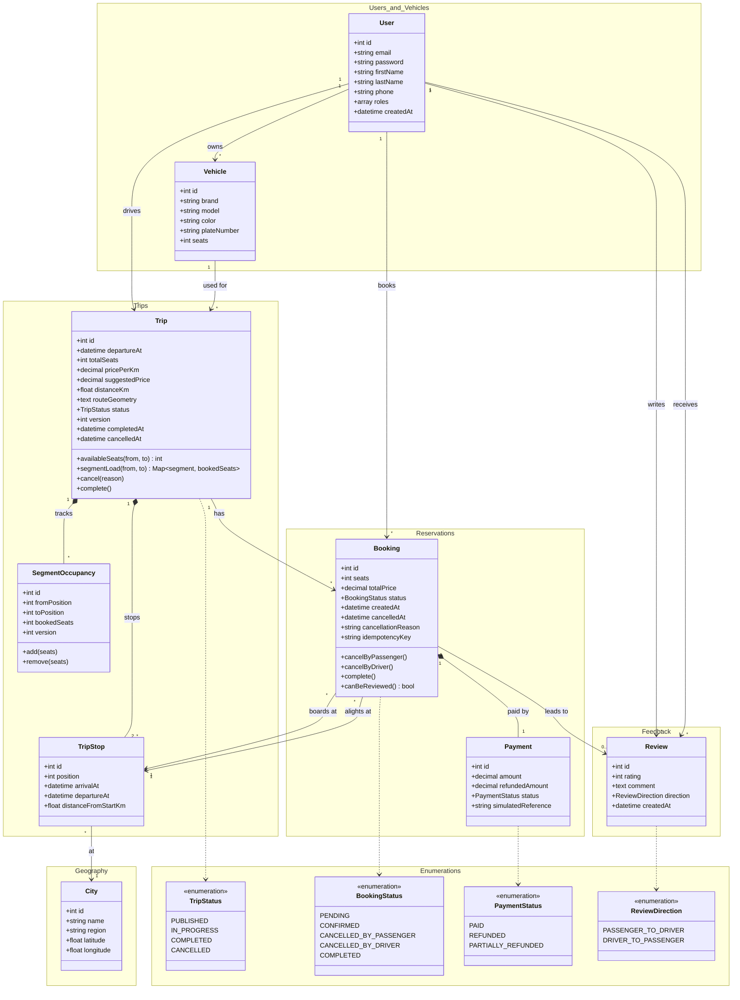

# Modèle de données - Plateforme de covoiturage.

Regional carpooling platform (Symfony 7.4 / MySQL 8 / Doctrine ORM).

This document contains:

1. the use case diagram
2. the class diagram

---

## 1. Use case diagram

---

## 2. Class diagram

---